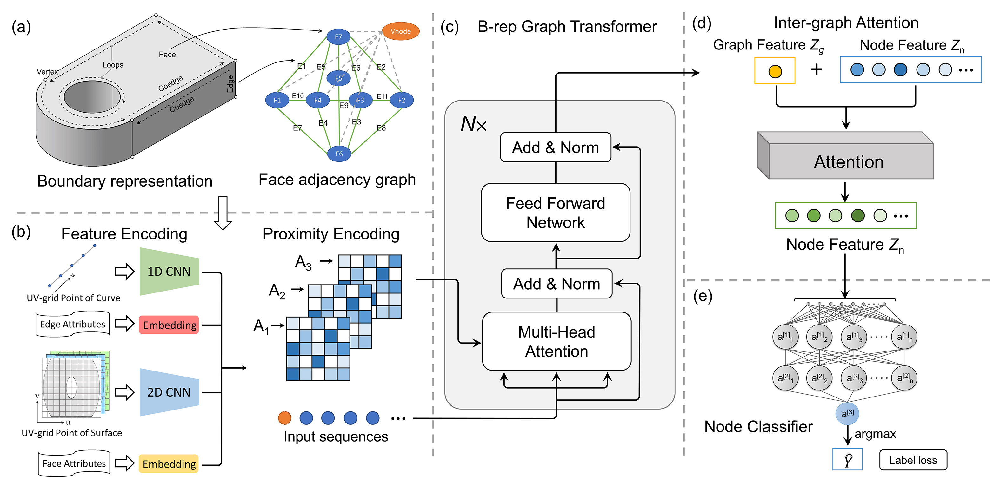

# BrepMFR

Code for BrepMFR: Enhancing machining feature recognition in B-rep models through deep learning and domain adaptation.

**Model Weights:** [https://huggingface.co/cad-weights/BrepMFR](https://huggingface.co/cad-weights/BrepMFR) — see [Model Weights](#model-weights) for every checkpoint and its local path



## About BrepMFR

BrepMFR, a novel deep learning network designed for machining feature recognition on B-rep models within the CAD/CAM domain. The original B-rep model is converted into a graph representation for network-friendly input, where graph nodes and edges respectively correspond to faces and edges of the original model. Subsequently, we leverage a graph neural network based on the Transformer architecture and graph attention mechanism to encode both local geometric shape and global topological relationships, achieving high-level semantic extraction and prediction of machining feature categories. Furthermore, to enhance the performance of neural networks on real-world CAD models, we adopt a two-step training strategy within a novel transfer learning framework.

## Preparation

### Environment Setup

There are two conda environments available:

| Environment | File | Python | PyTorch | CUDA | pythonocc | Use case |
|---|---|---|---|---|---|---|
| `brep_mfr` | `environment.yml` | 3.9 | 1.13 | 11.7 | 7.9.0 | Legacy: original BrepMFR model (`models/`) with DGL + fairseq |
| `new_brepmfr` | `modern_environment.yml` | 3.11 | 2.5+ | 12.1 | 7.9+ | Modern: BrepFormer (`brepformer/`), defeaturing v2, new development |

#### Option A: Modern environment (recommended for new work)

```bash
# One-step setup via script
./scripts/setup_env.sh

# Or manually
conda env create -f modern_environment.yml
conda activate new_brepmfr
```

#### Option B: Legacy environment (for original BrepMFR model)

```bash
conda env create -f environment.yml
conda activate brep_mfr
```

#### Environment management scripts

```bash
# Create the new_brepmfr environment
./scripts/setup_env.sh

# Check if environment exists and show key packages
./scripts/setup_env.sh --check

# Update existing environment from yml
./scripts/setup_env.sh --update

# Remove and recreate from scratch
./scripts/setup_env.sh --force

# Activate the environment (must be sourced)
source scripts/activate_env.sh
```

### Data preparation

Our synthetic CAD datasets have been publicly available on [Science Data Bank](https://www.scidb.cn/en/detail?dataSetId=931c088fd44f4d3e82891a5180f10d90)

The dataset directory should contain:
- `train.txt`, `val.txt`, `test.txt` - Text files listing the file stems (one per line)
- `.bin` files - Graph data files (can be in subdirectories)

Example dataset structure:
```
dataset/
├── train.txt
├── val.txt
├── test.txt
└── 000bin/
    ├── 00001234/
    │   └── 00001234_abc123_trimesh_000.bin
    └── ...
```

## Model Weights

All checkpoints are hosted at [huggingface.co/cad-weights/BrepMFR](https://huggingface.co/cad-weights/BrepMFR). The `results/` paths that the commands in this README and in `brepformer/` use are not committed to git. The table maps each HuggingFace file to the local path the scripts expect. It holds every checkpoint the docs reference, plus the best checkpoint from each training run.

Download one checkpoint to the path the scripts expect:

```bash
mkdir -p "results/trial1_finetune_ss/best-epoch=32-val"
huggingface-cli download cad-weights/BrepMFR trial1_finetune_ss/best-epoch32-f1_0.9354.ckpt --local-dir /tmp/brepmfr_hf
mv /tmp/brepmfr_hf/trial1_finetune_ss/best-epoch32-f1_0.9354.ckpt "results/trial1_finetune_ss/best-epoch=32-val/f1=0.9354.ckpt"
```

Or fetch everything with `huggingface-cli download cad-weights/BrepMFR --local-dir weights/`.

`val F1` is model-level multi-label F1, which is what the filenames record. `face F1` is per-face macro F1. These two metrics rank checkpoints differently. See [Face Segmentation on Real Parts](brepformer/README.md#face-segmentation-on-real-parts-defeature-5-class) for scores on real parts.

| HuggingFace file | Local path used by scripts | Metric | Notes |
|---|---|---|---|
| [`brepformer/best-epoch43-f1_0.8638.ckpt`](https://huggingface.co/cad-weights/BrepMFR/resolve/main/brepformer/best-epoch43-f1_0.8638.ckpt) | `results/brepformer/best-epoch=43-val/f1=0.8638.ckpt` | val F1 0.8638 | Legacy architecture (BatchNorm, single FFN); won't load into the current `BrepClassifier` |
| [`brepformer/best-epoch97-f1_0.8482.ckpt`](https://huggingface.co/cad-weights/BrepMFR/resolve/main/brepformer/best-epoch97-f1_0.8482.ckpt) | `results/brepformer/best-epoch=97-val/f1=0.8482.ckpt` | val F1 0.8482 | Legacy architecture (BatchNorm, single FFN); won't load into the current `BrepClassifier` |
| [`brepformer/best-epoch99-f1_0.8466.ckpt`](https://huggingface.co/cad-weights/BrepMFR/resolve/main/brepformer/best-epoch99-f1_0.8466.ckpt) | `results/brepformer/best-epoch=99-val/f1=0.8466.ckpt` | val F1 0.8466 | Legacy architecture (BatchNorm, single FFN); won't load into the current `BrepClassifier` |
| [`brepsimplifier/f1_0.9415.ckpt`](https://huggingface.co/cad-weights/BrepMFR/resolve/main/brepsimplifier/f1_0.9415.ckpt) | `brepformer/brepsimplifier/model_checkpoint/f1=0.9415.ckpt` | val F1 0.9415 | Same file as `trial1_ss1500` epoch 57; path BrepSimplifier expects |
| [`face_seg_heavy/best-epoch43-f1_0.8626.ckpt`](https://huggingface.co/cad-weights/BrepMFR/resolve/main/face_seg_heavy/best-epoch43-f1_0.8626.ckpt) | `results/face_seg_heavy/best-epoch=43-val/f1=0.8626.ckpt` | val F1 0.8626 | Legacy architecture (BatchNorm, single FFN); won't load into the current `BrepClassifier` |
| [`face_seg_heavy/best-epoch46-f1_0.8608.ckpt`](https://huggingface.co/cad-weights/BrepMFR/resolve/main/face_seg_heavy/best-epoch46-f1_0.8608.ckpt) | `results/face_seg_heavy/best-epoch=46-val/f1=0.8608.ckpt` | val F1 0.8608 | Legacy architecture (BatchNorm, single FFN); won't load into the current `BrepClassifier` |
| [`fix4_onehot_def/bestface-epoch81-face_f1_0.8714.ckpt`](https://huggingface.co/cad-weights/BrepMFR/resolve/main/fix4_onehot_def/bestface-epoch81-face_f1_0.8714.ckpt) | `results/fix4_onehot_def/bestface-epoch=81-val/face_f1=0.8714.ckpt` | face F1 0.8714 |  |
| [`fix8_uv_def/bestface-epoch60-face_f1_0.8577.ckpt`](https://huggingface.co/cad-weights/BrepMFR/resolve/main/fix8_uv_def/bestface-epoch60-face_f1_0.8577.ckpt) | `results/fix8_uv_def/bestface-epoch=60-val/face_f1=0.8577.ckpt` | face F1 0.8577 |  |
| [`fix8ctl_legacy_def/bestface-epoch00-face_f1_0.8653.ckpt`](https://huggingface.co/cad-weights/BrepMFR/resolve/main/fix8ctl_legacy_def/bestface-epoch00-face_f1_0.8653.ckpt) | `results/fix8ctl_legacy_def/bestface-epoch=00-val/face_f1=0.8653.ckpt` | face F1 0.8653 |  |
| [`pipe_classifier/best-epoch64-f1_0.5517.ckpt`](https://huggingface.co/cad-weights/BrepMFR/resolve/main/pipe_classifier/best-epoch64-f1_0.5517.ckpt) | `results/pipe_classifier/best-epoch=64-val/f1=0.5517.ckpt` | val F1 0.5517 | Different model class (pipe classifier) |
| [`t6_base/bestface-epoch01-face_f1_0.1255.ckpt`](https://huggingface.co/cad-weights/BrepMFR/resolve/main/t6_base/bestface-epoch01-face_f1_0.1255.ckpt) | `results/t6_base/bestface-epoch=01-val/face_f1=0.1255.ckpt` | face F1 0.1255 | Collapsed run, kept for the record |
| [`t6_f/bestface-epoch00-face_f1_0.1255.ckpt`](https://huggingface.co/cad-weights/BrepMFR/resolve/main/t6_f/bestface-epoch00-face_f1_0.1255.ckpt) | `results/t6_f/bestface-epoch=00-val/face_f1=0.1255.ckpt` | face F1 0.1255 | Collapsed run, kept for the record |
| [`t6_init_def/bestface-epoch00-face_f1_0.6958.ckpt`](https://huggingface.co/cad-weights/BrepMFR/resolve/main/t6_init_def/bestface-epoch00-face_f1_0.6958.ckpt) | `results/t6_init_def/bestface-epoch=00-val/face_f1=0.6958.ckpt` | face F1 0.6958 |  |
| [`t6_init_def_wf/bestface-epoch61-face_f1_0.8448.ckpt`](https://huggingface.co/cad-weights/BrepMFR/resolve/main/t6_init_def_wf/bestface-epoch61-face_f1_0.8448.ckpt) | `results/t6_init_def_wf/bestface-epoch=61-val/face_f1=0.8448.ckpt` | face F1 0.8448 |  |
| [`t6_init_ft/bestface-epoch52-face_f1_0.8212.ckpt`](https://huggingface.co/cad-weights/BrepMFR/resolve/main/t6_init_ft/bestface-epoch52-face_f1_0.8212.ckpt) | `results/t6_init_ft/bestface-epoch=52-val/face_f1=0.8212.ckpt` | face F1 0.8212 |  |
| [`t6_init_ft_wf/bestface-epoch47-face_f1_0.8378.ckpt`](https://huggingface.co/cad-weights/BrepMFR/resolve/main/t6_init_ft_wf/bestface-epoch47-face_f1_0.8378.ckpt) | `results/t6_init_ft_wf/bestface-epoch=47-val/face_f1=0.8378.ckpt` | face F1 0.8378 |  |
| [`t6_w/bestface-epoch00-face_f1_0.1982.ckpt`](https://huggingface.co/cad-weights/BrepMFR/resolve/main/t6_w/bestface-epoch00-face_f1_0.1982.ckpt) | `results/t6_w/bestface-epoch=00-val/face_f1=0.1982.ckpt` | face F1 0.1982 | Collapsed run, kept for the record |
| [`t6_wf/bestface-epoch00-face_f1_0.1942.ckpt`](https://huggingface.co/cad-weights/BrepMFR/resolve/main/t6_wf/bestface-epoch00-face_f1_0.1942.ckpt) | `results/t6_wf/bestface-epoch=00-val/face_f1=0.1942.ckpt` | face F1 0.1942 | Collapsed run, kept for the record |
| [`t6a_init_t5/bestface-epoch74-face_f1_0.8676.ckpt`](https://huggingface.co/cad-weights/BrepMFR/resolve/main/t6a_init_t5/bestface-epoch74-face_f1_0.8676.ckpt) | `results/t6a_init_t5/bestface-epoch=74-val/face_f1=0.8676.ckpt` | face F1 0.8676 |  |
| [`t6a_init_t5_wf/bestface-epoch62-face_f1_0.8642.ckpt`](https://huggingface.co/cad-weights/BrepMFR/resolve/main/t6a_init_t5_wf/bestface-epoch62-face_f1_0.8642.ckpt) | `results/t6a_init_t5_wf/bestface-epoch=62-val/face_f1=0.8642.ckpt` | face F1 0.8642 |  |
| [`t6a_init_t5_wf/bestface-epoch85-face_f1_0.8621.ckpt`](https://huggingface.co/cad-weights/BrepMFR/resolve/main/t6a_init_t5_wf/bestface-epoch85-face_f1_0.8621.ckpt) | `results/t6a_init_t5_wf/bestface-epoch=85-val/face_f1=0.8621.ckpt` | face F1 0.8621 |  |
| [`t6actl_init_t5/bestface-epoch60-face_f1_0.8877.ckpt`](https://huggingface.co/cad-weights/BrepMFR/resolve/main/t6actl_init_t5/bestface-epoch60-face_f1_0.8877.ckpt) | `results/t6actl_init_t5/bestface-epoch=60-val/face_f1=0.8877.ckpt` | face F1 0.8877 |  |
| [`t6actl_init_t5/bestface-epoch61-face_f1_0.8873.ckpt`](https://huggingface.co/cad-weights/BrepMFR/resolve/main/t6actl_init_t5/bestface-epoch61-face_f1_0.8873.ckpt) | `results/t6actl_init_t5/bestface-epoch=61-val/face_f1=0.8873.ckpt` | face F1 0.8873 |  |
| [`t6ctl_base/bestface-epoch01-face_f1_0.1001.ckpt`](https://huggingface.co/cad-weights/BrepMFR/resolve/main/t6ctl_base/bestface-epoch01-face_f1_0.1001.ckpt) | `results/t6ctl_base/bestface-epoch=01-val/face_f1=0.1001.ckpt` | face F1 0.1001 | Collapsed run, kept for the record |
| [`t6ctl_init_ft/bestface-epoch00-face_f1_0.8637.ckpt`](https://huggingface.co/cad-weights/BrepMFR/resolve/main/t6ctl_init_ft/bestface-epoch00-face_f1_0.8637.ckpt) | `results/t6ctl_init_ft/bestface-epoch=00-val/face_f1=0.8637.ckpt` | face F1 0.8637 |  |
| [`t6ctl_wf/bestface-epoch02-face_f1_0.0887.ckpt`](https://huggingface.co/cad-weights/BrepMFR/resolve/main/t6ctl_wf/bestface-epoch02-face_f1_0.0887.ckpt) | `results/t6ctl_wf/bestface-epoch=02-val/face_f1=0.0887.ckpt` | face F1 0.0887 | Collapsed run, kept for the record |
| [`trial1_finetune_ss/best-epoch26-f1_0.9356.ckpt`](https://huggingface.co/cad-weights/BrepMFR/resolve/main/trial1_finetune_ss/best-epoch26-f1_0.9356.ckpt) | `results/trial1_finetune_ss/best-epoch=26-val/f1=0.9356.ckpt` | val F1 0.9356 |  |
| [`trial1_finetune_ss/best-epoch32-f1_0.9354.ckpt`](https://huggingface.co/cad-weights/BrepMFR/resolve/main/trial1_finetune_ss/best-epoch32-f1_0.9354.ckpt) | `results/trial1_finetune_ss/best-epoch=32-val/f1=0.9354.ckpt` | val F1 0.9354 | **Recommended** — best face macro F1 on real parts (0.8886) |
| [`trial1_finetune_ss/last.ckpt`](https://huggingface.co/cad-weights/BrepMFR/resolve/main/trial1_finetune_ss/last.ckpt) | `results/trial1_finetune_ss/last.ckpt` | — |  |
| [`trial1_ss/best-epoch41-f1_0.9476.ckpt`](https://huggingface.co/cad-weights/BrepMFR/resolve/main/trial1_ss/best-epoch41-f1_0.9476.ckpt) | `results/trial1_ss/best-epoch=41-val/f1=0.9476.ckpt` | val F1 0.9476 |  |
| [`trial1_ss/last.ckpt`](https://huggingface.co/cad-weights/BrepMFR/resolve/main/trial1_ss/last.ckpt) | `results/trial1_ss/last.ckpt` | — |  |
| [`trial1_ss1000/best-epoch28-f1_0.9146.ckpt`](https://huggingface.co/cad-weights/BrepMFR/resolve/main/trial1_ss1000/best-epoch28-f1_0.9146.ckpt) | `results/trial1_ss1000/best-epoch=28-val/f1=0.9146.ckpt` | val F1 0.9146 |  |
| [`trial1_ss1500/best-epoch43-f1_0.9425.ckpt`](https://huggingface.co/cad-weights/BrepMFR/resolve/main/trial1_ss1500/best-epoch43-f1_0.9425.ckpt) | `results/trial1_ss1500/best-epoch=43-val/f1=0.9425.ckpt` | val F1 0.9425 |  |
| [`trial1_ss1500/best-epoch46-f1_0.9455.ckpt`](https://huggingface.co/cad-weights/BrepMFR/resolve/main/trial1_ss1500/best-epoch46-f1_0.9455.ckpt) | `results/trial1_ss1500/best-epoch=46-val/f1=0.9455.ckpt` | val F1 0.9455 |  |
| [`trial1_ss1500/best-epoch57-f1_0.9415.ckpt`](https://huggingface.co/cad-weights/BrepMFR/resolve/main/trial1_ss1500/best-epoch57-f1_0.9415.ckpt) | `results/trial1_ss1500/best-epoch=57-val/f1=0.9415.ckpt` | val F1 0.9415 | `defeature_v2.py` default |
| [`trial1_ss1500/last.ckpt`](https://huggingface.co/cad-weights/BrepMFR/resolve/main/trial1_ss1500/last.ckpt) | `results/trial1_ss1500/last.ckpt` | — |  |
| [`trial2/best-epoch111-f1_0.8558.ckpt`](https://huggingface.co/cad-weights/BrepMFR/resolve/main/trial2/best-epoch111-f1_0.8558.ckpt) | `results/trial2/best-epoch=111-val/f1=0.8558.ckpt` | val F1 0.8558 | Legacy architecture (BatchNorm, single FFN); won't load into the current `BrepClassifier` |
| [`trial2_finetune_ss/best-epoch28-f1_0.9289.ckpt`](https://huggingface.co/cad-weights/BrepMFR/resolve/main/trial2_finetune_ss/best-epoch28-f1_0.9289.ckpt) | `results/trial2_finetune_ss/best-epoch=28-val/f1=0.9289.ckpt` | val F1 0.9289 |  |
| [`trial2_finetune_ss/last.ckpt`](https://huggingface.co/cad-weights/BrepMFR/resolve/main/trial2_finetune_ss/last.ckpt) | `results/trial2_finetune_ss/last.ckpt` | — |  |
| [`trial3/best-epoch41-f1_0.8799.ckpt`](https://huggingface.co/cad-weights/BrepMFR/resolve/main/trial3/best-epoch41-f1_0.8799.ckpt) | `results/trial3/best-epoch=41-val/f1=0.8799.ckpt` | val F1 0.8799 | Legacy architecture (BatchNorm, single FFN); won't load into the current `BrepClassifier` |
| [`trial3/best-epoch42-f1_0.8795.ckpt`](https://huggingface.co/cad-weights/BrepMFR/resolve/main/trial3/best-epoch42-f1_0.8795.ckpt) | `results/trial3/best-epoch=42-val/f1=0.8795.ckpt` | val F1 0.8795 | Legacy architecture (BatchNorm, single FFN); won't load into the current `BrepClassifier` |
| [`trial4/best-epoch26-f1_0.8839.ckpt`](https://huggingface.co/cad-weights/BrepMFR/resolve/main/trial4/best-epoch26-f1_0.8839.ckpt) | `results/trial4/best-epoch=26-val/f1=0.8839.ckpt` | val F1 0.8839 | Legacy architecture (BatchNorm, single FFN); won't load into the current `BrepClassifier` |
| [`trial5/best-epoch39-f1_0.8832.ckpt`](https://huggingface.co/cad-weights/BrepMFR/resolve/main/trial5/best-epoch39-f1_0.8832.ckpt) | `results/trial5/best-epoch=39-val/f1=0.8832.ckpt` | val F1 0.8832 | 27-class MFTRCAD |
| [`trial5/best-epoch43-f1_0.8823.ckpt`](https://huggingface.co/cad-weights/BrepMFR/resolve/main/trial5/best-epoch43-f1_0.8823.ckpt) | `results/trial5/best-epoch=43-val/f1=0.8823.ckpt` | val F1 0.8823 | 27-class MFTRCAD |

## Training

### Using the Compatibility Wrapper (Recommended)

The wrapper script (`train_wrapper.py`) provides compatibility with newer versions of NumPy (1.24+) and PyTorch Lightning (2.x):

```bash
python train_wrapper.py train --dataset_path /path/to/dataset --max_epochs 100 --batch_size 64
```

#### Wrapper Arguments

| Argument | Default | Description |
|----------|---------|-------------|
| `--dataset_path` | (required) | Path to the dataset directory |
| `--max_epochs` | 100 | Maximum number of training epochs |
| `--batch_size` | 64 | Batch size for training |
| `--num_workers` | 12 | Number of data loader workers (set to 0 on Windows) |
| `--num_classes` | 25 | Number of feature classes |
| `--experiment_name` | BrepMFR | Experiment name (creates folder in `results/`) |
| `--devices` | 1 | Number of GPUs to use |
| `--gradient_clip_val` | 1.0 | Gradient clipping value |
| `--dropout` | 0.3 | Dropout rate |
| `--d_model` | 512 | Transformer model dimension |
| `--n_heads` | 32 | Number of attention heads |
| `--n_layers_encode` | 8 | Number of encoder layers |

### Using the Original Script

For older environments (NumPy < 1.24, PyTorch Lightning 1.x):

```bash
python segmentation.py train --dataset_path /path/to/dataset --max_epochs 1000 --batch_size 64
```

### Monitoring Training

The logs and checkpoints will be stored in a folder called `results/BrepMFR` based on the experiment name and timestamp, and can be monitored with Tensorboard:

```bash
tensorboard --logdir results/<experiment_name>
```

## Testing

### Using the Compatibility Wrapper (Recommended)

```bash
python train_wrapper.py test --dataset_path /path/to/dataset --checkpoint ./results/BrepMFR/<date>/<time>/best.ckpt --batch_size 64
```

### Using the Original Script

```bash
python segmentation.py test --dataset_path /path/to/dataset --checkpoint ./results/BrepMFR/best.ckpt --batch_size 64
```

## Compatibility Notes

The `train_wrapper.py` script addresses the following compatibility issues:

1. **NumPy 1.24+**: The deprecated `np.int`, `np.float`, and `np.bool` aliases were removed. The wrapper adds these aliases back automatically.

2. **PyTorch Lightning 2.x**: Several API changes were made:
   - `training_epoch_end` → `on_train_epoch_end`
   - `validation_epoch_end` → `on_validation_epoch_end`
   - `test_epoch_end` → `on_test_epoch_end`
   - `Trainer.from_argparse_args()` deprecated
   - `auto_select_gpus` argument removed

---

## BrepFormer: Automatic Defeaturing

The defeaturing pipeline classifies each face of a B-rep STEP model as random (stock), hole, chamfer, fillet, or cut, then removes all detected manufacturing features using OpenCASCADE's `BRepAlgoAPI_Defeaturing`, leaving only the base stock shape.

Two engine versions are available:

| Engine | Module | Requires | Status |
|---|---|---|---|
| **v2** (recommended) | `brepformer.defeature_v2` | pythonocc >= 7.9 | Modern engine with adaptive tolerance and enhanced healing |
| v1 | `brepformer.defeature` | pythonocc >= 7.5 | Original 5-phase progressive engine |

### Quick Start

```bash
# Activate modern environment
source scripts/activate_env.sh

# Defeature a single file (v2 engine, default)
./scripts/run_defeature.sh --step model.step

# Defeature a directory
./scripts/run_defeature.sh --step_dir steps/ --verbose

# Use v1 engine explicitly
./scripts/run_defeature.sh --engine v1 --step model.step
```

Or call the Python modules directly:

```bash
# v2 engine
python -m brepformer.defeature_v2 --step model.step

# v1 engine
python -m brepformer.defeature --step model.step

# Custom checkpoint and output
python -m brepformer.defeature_v2 --step model.step \
    --checkpoint results/my_model/best.ckpt \
    --output_dir output/
```

### Defeature v2 Engine — What's New

`defeature_v2.py` is a drop-in replacement for the original `defeature.py` with the same CLI interface. It targets the core limitation of v1 — faces that fail to remove due to borderline geometry tolerance — by adding six improvements:

#### 1. Adaptive Fuzzy Tolerance

When defeaturing fails at the default geometric tolerance (~1e-7), v2 automatically retries with progressively relaxed `SetFuzzyValue()`:

```
Tolerance ladder: 0 (default) → 1e-5 → 5e-5 → 1e-4 → 5e-4 → 1e-3
```

This is the single biggest improvement. Fillet faces that blend two non-planar surfaces often fail at tight tolerance because the gap-healing algorithm cannot close the intersection precisely enough. Relaxing by even 1e-5 is often sufficient.

The maximum tolerance is configurable:

```bash
# Allow up to 0.01 tolerance for very difficult models
python -m brepformer.defeature_v2 --step model.step --max_fuzzy 0.01
```

#### 2. History-Based Face Tracking

v1 uses `IndexedMap.Contains()` to check if an original face still exists in the modified shape between phases. This is fragile — when defeaturing modifies adjacent faces (extending them to fill gaps), the modified face has different identity from the original.

v2 uses `BRepTools_History` returned by the OCCT kernel (available since OCCT 7.4):
- `history.IsRemoved(face)` — was this face removed (directly or as side-effect)?
- `history.Modified(face)` — was this face reshaped? Returns the new version.

This precisely tracks what happened to every face, eliminating "lost face" bugs between phases.

#### 3. Pre-Validation and Auto-Repair

Before any defeaturing attempt, v2 validates the input shape with `BRepCheck_Analyzer`. If issues are found:
1. `ShapeFix_ShapeTolerance.LimitTolerance()` harmonizes face/edge tolerances to a sane range (1e-7 to 1e-3)
2. `ShapeFix_Shape.Perform()` fixes degenerate edges, bad wires, and face issues

Corrupted input geometry is a silent source of defeaturing failures. Pre-repair prevents them.

#### 4. Enhanced Healing Pipeline

After defeaturing, v2 runs a multi-stage repair chain instead of just `ShapeFix_Shape` + `UnifySameDomain`:

1. **Tolerance harmonization** — `ShapeFix_ShapeTolerance.LimitTolerance()` caps face/edge tolerances
2. **General shape fix** — `ShapeFix_Shape.Perform()` with configurable precision
3. **Conditional sewing** — `BRepBuilderAPI_Sewing` closes microscopic gaps (only runs if shape is invalid after step 2)
4. **Face unification** — `ShapeUpgrade_UnifySameDomain` with angular tolerance (1e-3 rad, ~0.06 degrees) and linear tolerance (1e-5, 10 microns) for merging nearly-coplanar faces that v1 would leave split

#### 5. Area-Based Ordering

Connected-component groups and individual retry faces are sorted by total surface area (smallest first). Smaller features have higher first-attempt success rates, and their removal often changes the topology enough to unblock adjacent larger features that previously failed.

#### 6. Intermediate Healing

In the single-face iterative phase (Phase 5c), v2 runs a quick `UnifySameDomain` pass after each successful removal. This improves geometry quality before the next attempt, cascading more successes.

### v2 CLI Reference

```bash
python -m brepformer.defeature_v2 [args]
```

| Argument | Default | Description |
|----------|---------|-------------|
| `--step` | None | Path to a single STEP file |
| `--step_dir` | None | Directory of STEP files (batch mode) |
| `--checkpoint` | `results/trial1_ss1500/best-epoch=57-val/f1=0.9415.ckpt` | Model checkpoint (must have face segmentation head) |
| `--seg` | None | Path to .seg file with pre-computed predictions (single mode) |
| `--seg_dir` | None | Directory of .seg prediction files (batch mode) |
| `--output_dir` | `brepformer/defeatured_output` | Output directory for defeatured STEP files |
| `--save_colored` | False | Also save a colored STEP showing predictions before defeaturing |
| `--verbose` | False | Print detailed per-phase defeaturing progress |
| `--max_fuzzy` | `1e-3` | Maximum fuzzy tolerance for adaptive retry (v2 only) |

### v2 Phase Algorithm

```
Phase 0 — Pre-validate input shape (auto-repair if needed)
Phase 1 — Try ALL features at once (adaptive tolerance: 0 → 1e-5 → ... → 1e-3)
Phase 2 — Progressive type-by-type: fillet → chamfer → hole → cut (adaptive)
Phase 3 — Connected components per failed type (area-sorted, adaptive)
Phase 4 — Retry remaining on modified shape (history-based face tracking, adaptive)
Phase 5 — Last-ditch fallbacks:
  5a. Fillets only → then remaining types
  5b. Reverse order (cut → hole → chamfer → fillet)
  5c. Single-face iterative (area-sorted, adaptive, intermediate healing)
Cleanup — Multi-stage healing: tolerance harmonization → shape fix → sewing → face unification
```

### Output Structure

```
brepformer/defeatured_output/
├── model_id_defeatured.step    # Defeatured STEP file (stock shape)
├── model_id_colored.step       # Colored predictions (if --save_colored)
├── model_id_report.json        # Per-model defeaturing report
└── batch_report.json           # Batch summary (batch mode only)
```

**Report JSON fields:**

| Field | Description |
|-------|-------------|
| `status` | `"success"`, `"no_features"`, or `"error"` |
| `num_faces` | Total faces in input model |
| `kept` | Faces classified as random (kept) |
| `removed` | Feature faces successfully removed |
| `failed` | Feature faces that could not be removed |
| `valid` | Whether the output shape passes BRepCheck validation |
| `elapsed_s` | Defeaturing time in seconds (v2 only) |

### Usage Examples

```bash
# ─── Single file ─────────────────────────────────────────────
# v2 engine with default checkpoint
./scripts/run_defeature.sh --step model.step

# Verbose output showing all phases
./scripts/run_defeature.sh --step model.step --verbose

# Higher tolerance for a difficult model with complex fillets
./scripts/run_defeature.sh --step complex_model.step --max_fuzzy 0.01 --verbose

# Also save colored STEP for visual comparison in FreeCAD
./scripts/run_defeature.sh --step model.step --save_colored

# Custom checkpoint
./scripts/run_defeature.sh --step model.step \
    --checkpoint "results/trial1_ss1500/best-epoch=57-val/f1=0.9415.ckpt"

# From pre-computed .seg predictions (skip inference, faster)
./scripts/run_defeature.sh --step model.step --seg preds.seg

# ─── Batch mode ──────────────────────────────────────────────
# Defeature all STEP files in a directory
./scripts/run_defeature.sh --step_dir brepformer/data/defeature/steps/

# Batch with pre-computed predictions
./scripts/run_defeature.sh --step_dir brepformer/data/defeature/steps/ \
    --seg_dir inference/trial1_ss1500/

# Batch with custom output directory and colored STEPs
./scripts/run_defeature.sh --step_dir steps/ \
    --output_dir my_output/ --save_colored --verbose

# ─── Engine comparison ───────────────────────────────────────
# Use the original v1 engine
./scripts/run_defeature.sh --engine v1 --step model.step --verbose

# v2 engine (default)
./scripts/run_defeature.sh --engine v2 --step model.step --verbose

# ─── Full pipeline: inference + defeature ────────────────────
# Step 1: Run inference
python -m brepformer.infer \
    --step_dir brepformer/data/defeature/steps/ \
    --checkpoint "results/trial1_ss1500/best-epoch=57-val/f1=0.9415.ckpt" \
    --output_dir inference/trial1_ss1500/

# Step 2: Defeature using inference results
./scripts/run_defeature.sh --step_dir brepformer/data/defeature/steps/ \
    --seg_dir inference/trial1_ss1500/ \
    --output_dir brepformer/defeatured_output/ \
    --save_colored --verbose

# Or combine inference + defeaturing in one command (runs model internally)
./scripts/run_defeature.sh --step_dir brepformer/data/defeature/steps/ \
    --checkpoint "results/trial1_ss1500/best-epoch=57-val/f1=0.9415.ckpt" \
    --output_dir brepformer/defeatured_output/
```

### Verbose Output Example (v2)

```
Defeaturing model.step (v2 engine)...
  Predictions (156 faces):
    random: 42 [keep]
    hole: 28 [REMOVE]
    chamfer: 8 [REMOVE]
    fillet: 52 [REMOVE]
    cut: 26 [REMOVE]
  Faces: 156 total, 42 random, 114 features
    fillet: 52
    chamfer: 8
    hole: 28
    cut: 26
    Phase 1 failed (114 faces), trying progressive...
    Phase 2 + fillet: all 52 faces (total: 52)
    Phase 2 + chamfer: all 8 faces (total: 60)
    Phase 3 hole: 28 faces in 6 groups (sizes: [2, 2, 4, 4, 8, 8])
      + group of 2 hole faces
      + group of 2 hole faces
      + group of 4 hole faces
      + group of 4 hole faces
      + group of 8 hole faces
        (succeeded at fuzzy=1e-05)
      + group of 8 hole faces
      hole: 28/28 removed
    Phase 2 + cut: all 26 faces (total: 114)

  Removed 114 feature faces (failed: 0)
  Shape valid: True
  Time: 4.21s
  Output: brepformer/defeatured_output/model_defeatured.step
```

### Known Limitation: Fillet Removal

`BRepAlgoAPI_Defeaturing` removes faces by extending adjacent faces to fill the gap — it does not simply delete geometry. This is robust for holes, chamfers, and cuts, but **fillets can be challenging**:

- Fillets that blend two non-planar surfaces at complex topology may fail because the healing kernel cannot compute the intersection of the extended surfaces.
- v2's adaptive tolerance resolves most of these cases by allowing slightly larger geometric gaps.
- In the remaining worst case, the face is left in place and counted as `failed` in the report.
- Processing time scales non-linearly for models with many interdependent fillets (300+ faces with many fillets can take several minutes).

### Test Results: Top 50 Largest Models

The pipeline was tested on the 50 models with the most faces from the defeature dataset (range: 242-1395 faces). All 50 completed successfully with **0 faces failing to remove** and **all output shapes valid**.

Results for the 23 models with detailed stats:

| Model | Faces | Kept | Removed | Failed | Valid | Feature% |
|---|---:|---:|---:|---:|---:|---:|
| uh62382 | 1395 | 952 | 443 | 0 | Y | 31% |
| plaque_tubulaire | 808 | 4 | 804 | 0 | Y | 99% |
| chicane | 756 | 6 | 750 | 0 | Y | 99% |
| TeaCoaster | 594 | 6 | 588 | 0 | Y | 98% |
| SWP-10017_modified | 384 | 70 | 314 | 0 | Y | 81% |
| Complex_Sheet_Metal_Part | 370 | 166 | 204 | 0 | Y | 55% |
| gear-_caddy | 357 | 199 | 158 | 0 | Y | 44% |
| DDLLINCGD0103 | 331 | 22 | 309 | 0 | Y | 93% |
| uh68595 | 326 | 10 | 316 | 0 | Y | 96% |
| gu100067 | 314 | 55 | 259 | 0 | Y | 82% |
| h00301-0002_reva_1_1 | 300 | 102 | 198 | 0 | Y | 66% |
| Ryan_Blystone (Roll Top Track Mount) | 293 | 23 | 270 | 0 | Y | 92% |
| MLLANINGD0781 | 292 | 75 | 217 | 0 | Y | 74% |
| VBP31-F103-R100-N50-001 | 284 | 132 | 152 | 0 | Y | 53% |
| schaal_d131_25-55g | 283 | 35 | 248 | 0 | Y | 87% |
| p-p017 | 278 | 4 | 274 | 0 | Y | 98% |
| SWP-08186 | 274 | 21 | 253 | 0 | Y | 92% |
| EMI_shielding_case | 268 | 38 | 230 | 0 | Y | 85% |
| ib_ob_item_120x80_item_120_x_80 | 264 | 14 | 250 | 0 | Y | 94% |
| hbld01062706 | 257 | 26 | 231 | 0 | Y | 89% |
| sv3307_1_1 | 254 | 144 | 110 | 0 | Y | 43% |
| DDLLINCGD0012 | 247 | 37 | 210 | 0 | Y | 85% |
| swing_check_valve_fl_-_150-2500 | 246 | 197 | 49 | 0 | Y | 19% |

**Batch 2 total: 6,837 feature faces removed, 0 failed, 23/23 valid shapes.**

The remaining 27 models (sizes 242-1077 faces) also all completed with no errors. One OCC segfault occurred at the OS/WSL2 level between the two batches (not a defeaturing failure) and did not affect any output files.

---

## Inference and Visualization Pipeline

The BrepFormer pipeline classifies each face of a B-rep STEP model, exports colored visualizations, and optionally defeatures the model. Three class taxonomies are available:

| Mode | Classes | Flag | Description |
|------|---------|------|-------------|
| Full | 27 | *(default)* | All MFTRCAD machining feature classes |
| Grouped | 8 | `--8_classes` | Grouped into: other, through_hole, blind_hole, chamfer, fillet, through_cut, blind_cut, extrude |
| Defeature | 5 | `--5_classes` | Grouped into: random, hole, chamfer, fillet, cut |

### All-in-One Pipeline Script

```bash
./brepformer/scripts/inference_pipeline.sh brepformer/data/defeature/steps/uh62382.step
```

This runs the full 6-step pipeline (inference → FreeCAD export → analysis → visualize_seg → defeature → visualize_defeature). See `brepformer/scripts/inference_pipeline.sh --help` for options.

### Manual Pipeline (27-class, default)

```bash
# 1. Inference — predict per-face labels
python -m brepformer.infer \
    --step brepformer/data/defeature/steps/uh62382.step \
    --checkpoint "results/trial1_ss1500/best-epoch=57-val/f1=0.9415.ckpt" \
    --output brepformer/pipeline_output/uh62382/preds.seg

# 2. Colored STEP export for FreeCAD
python -m brepformer.export_freecad \
    --step brepformer/data/defeature/steps/uh62382.step \
    --seg brepformer/pipeline_output/uh62382/preds.seg \
    --output brepformer/pipeline_output/uh62382/uh62382_colored.step

# 3. Visualize face segmentation (interactive 3D viewer)
python -m brepformer.visualize_seg \
    --step brepformer/data/defeature/steps/uh62382.step \
    --seg brepformer/pipeline_output/uh62382/preds.seg

# 4. Defeature — remove predicted manufacturing features
python -m brepformer.defeature_v2 \
    --step brepformer/data/defeature/steps/uh62382.step \
    --seg brepformer/pipeline_output/uh62382/preds.seg \
    --output_dir brepformer/pipeline_output/uh62382/

# 5. Visualize defeatured result (original vs defeatured comparison)
python -m brepformer.visualize_defeature \
    --step brepformer/data/defeature/steps/uh62382.step \
    --defeatured brepformer/pipeline_output/uh62382/uh62382_defeatured.step \
    --seg brepformer/pipeline_output/uh62382/preds.seg
```

### Pipeline with 8-class Grouping

```bash
# 1. Inference with 8-class remapping
python -m brepformer.infer \
    --step brepformer/data/defeature/steps/uh62382.step \
    --checkpoint "results/trial1_ss1500/best-epoch=57-val/f1=0.9415.ckpt" \
    --output brepformer/pipeline_output/uh62382/preds_8class.seg --8_classes

# 2. Colored STEP export (8-class palette)
python -m brepformer.export_freecad \
    --step brepformer/data/defeature/steps/uh62382.step \
    --seg brepformer/pipeline_output/uh62382/preds_8class.seg \
    --output brepformer/pipeline_output/uh62382/uh62382_colored_8class.step \
    --8_classes

# 3. Visualize segmentation (8-class coloring)
python -m brepformer.visualize_seg \
    --step brepformer/data/defeature/steps/uh62382.step \
    --seg brepformer/pipeline_output/uh62382/preds_8class.seg \
    --8_classes

# 4. Defeature (uses original 5-class predictions internally)
python -m brepformer.defeature_v2 \
    --step brepformer/data/defeature/steps/uh62382.step \
    --seg brepformer/pipeline_output/uh62382/preds.seg \
    --output_dir brepformer/pipeline_output/uh62382/

# 5. Visualize defeatured (original vs defeatured comparison)
python -m brepformer.visualize_defeature \
    --step brepformer/data/defeature/steps/uh62382.step \
    --defeatured brepformer/pipeline_output/uh62382/uh62382_defeatured.step \
    --seg brepformer/pipeline_output/uh62382/preds.seg
```

### Pipeline with 5-class Defeature Categories

```bash
# 1. Inference with 5-class remapping
python -m brepformer.infer \
    --step brepformer/data/defeature/steps/uh62382.step \
    --checkpoint "results/trial1_ss1500/best-epoch=57-val/f1=0.9415.ckpt" \
    --output brepformer/pipeline_output/uh62382/preds_5class.seg --5_classes

# 2. Colored STEP export (5-class palette)
python -m brepformer.export_freecad \
    --step brepformer/data/defeature/steps/uh62382.step \
    --seg brepformer/pipeline_output/uh62382/preds_5class.seg \
    --output brepformer/pipeline_output/uh62382/uh62382_colored_5class.step \
    --5_classes

# 3. Visualize segmentation (5-class coloring)
python -m brepformer.visualize_seg \
    --step brepformer/data/defeature/steps/uh62382.step \
    --seg brepformer/pipeline_output/uh62382/preds_5class.seg \
    --5_classes

# 4. Defeature (5-class .seg is natively compatible)
python -m brepformer.defeature_v2 \
    --step brepformer/data/defeature/steps/uh62382.step \
    --seg brepformer/pipeline_output/uh62382/preds_5class.seg \
    --output_dir brepformer/pipeline_output/uh62382/

# 5. Visualize defeatured (original vs defeatured comparison)
python -m brepformer.visualize_defeature \
    --step brepformer/data/defeature/steps/uh62382.step \
    --defeatured brepformer/pipeline_output/uh62382/uh62382_defeatured.step \
    --seg brepformer/pipeline_output/uh62382/preds_5class.seg
```

---

## Scripts Reference

All helper scripts are in the `scripts/` directory.

| Script | Usage | Description |
|---|---|---|
| `scripts/setup_env.sh` | `./scripts/setup_env.sh` | Create/update/check the `new_brepmfr` conda environment |
| `scripts/activate_env.sh` | `source scripts/activate_env.sh` | Activate `new_brepmfr` and print version info |
| `scripts/run_defeature.sh` | `./scripts/run_defeature.sh --step model.step` | Run defeaturing (v1 or v2 engine) |

For the full BrepFormer scripts reference (training, testing, inference, analysis, visualization), see [brepformer/SCRIPTS.md](brepformer/SCRIPTS.md).
